<p align="center">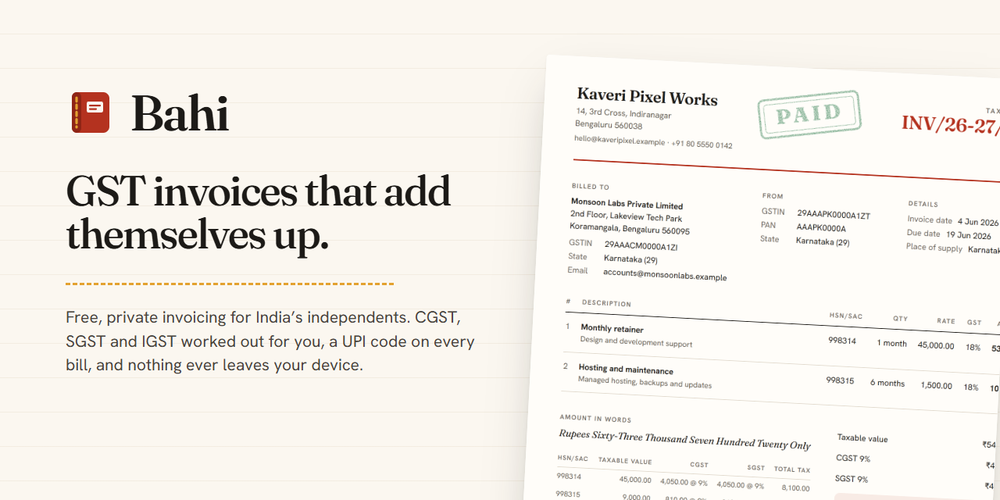</p>

**Bahi makes GST-ready invoices for India's freelancers and small studios. It is free and private, and it runs entirely on your device.**

[](https://github.com/Darshanpawar7/bahi/actions/workflows/ci.yml)
[](LICENSE)
[](https://darshanpawar7.github.io/bahi/)

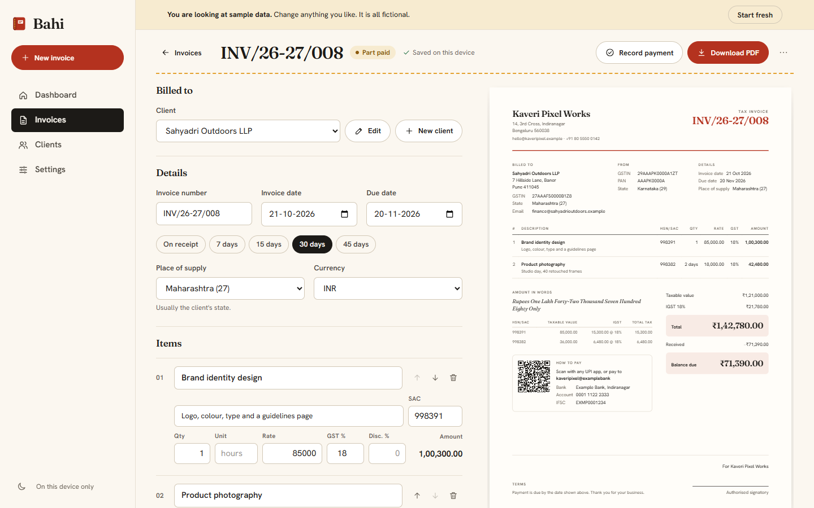

## Why it exists

An Indian freelancer's invoice has to get the tax right: CGST and SGST when the client is in the same state, IGST when they are not, nothing on an export under a Letter of Undertaking. It also needs SAC codes, the amount in words and, ideally, a UPI code the client can scan. The tools that do this are either full accounting suites, free only up to a handful of invoices, or they want an account and keep your client list on their servers. So most freelancers fall back to a Word template and do the tax by hand.

Bahi does the tax for you and keeps nothing on a server. You type on the left, a real A4 invoice builds itself on the right, and one click gives you a PDF with selectable text and a UPI QR code. Everything is stored in your browser, works offline, and backs up to a file you keep.

The name comes from the _bahi-khata_, the red cloth-bound ledger Indian traders have kept for centuries.

## Features

- **The tax, decided for you.** The supply type comes from your state and the place of supply: CGST and SGST (or UTGST in union territories without a legislature), IGST, or zero-rated exports with or without IGST. Composition and unregistered suppliers get a bill of supply or a plain invoice with no tax.
- **A live A4 sheet** that updates as you type, with an HSN/SAC tax summary, the amount in words in Indian numbering, and a rubber stamp once an invoice is paid.
- **PDF output** through the browser's print engine: vector text you can select, embedded fonts with the rupee sign, and a sharp QR code.
- **UPI QR codes** for the balance due on rupee invoices.
- **Payments and TDS.** You can record part payments and the TDS your client deducted, and see a helper that estimates the TDS before you send.
- **A dashboard** for the financial year (April to March): invoiced, received, outstanding and overdue, a month-by-month chart, and a list of what needs attention.
- **GSTIN validation** that checks the checksum, not just the shape, and fills in the state and PAN.
- **Invoice numbers** in the legal shape (at most 16 characters), restarting each financial year and never reused.
- **Export invoices** in seven foreign currencies, with an optional exchange rate for the dashboard.
- **Backups** as a plain JSON file. On import the file is checked field by field before anything is replaced.
- **Installable and offline**, in light and dark themes, and usable from 360 px phones to wide screens.

## Screenshots

| Dashboard                                                                                                 | Paid invoice                                                                                   |
| --------------------------------------------------------------------------------------------------------- | ---------------------------------------------------------------------------------------------- |
| 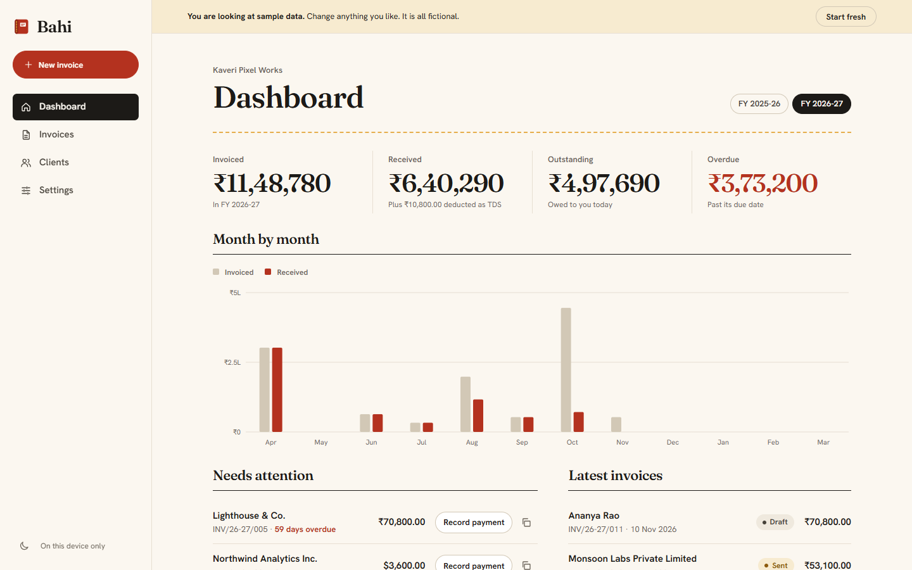 | 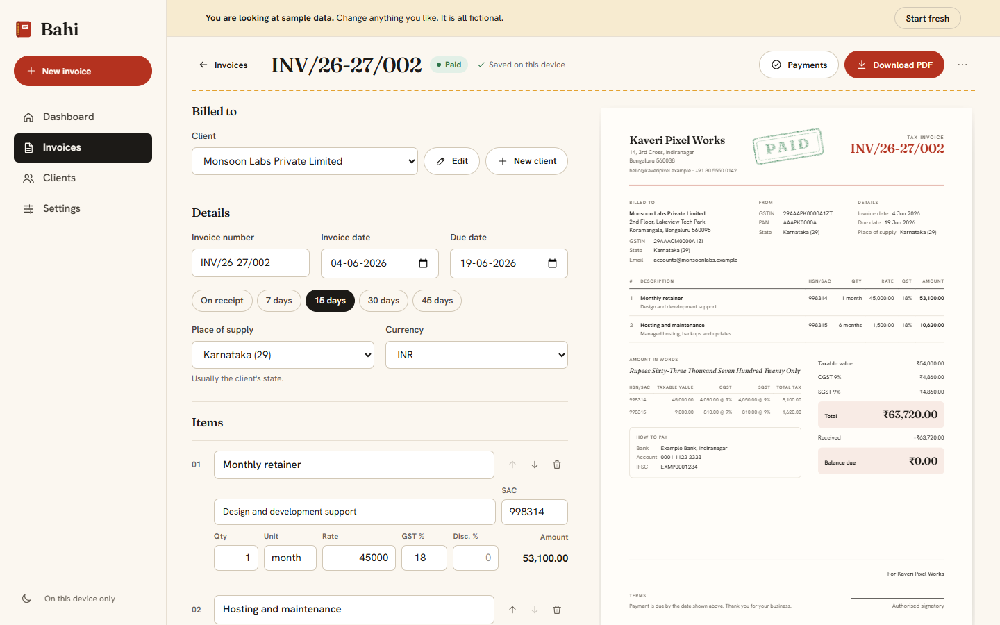           |
| **Invoices**                                                                                              | **Dark theme**                                                                                 |
| 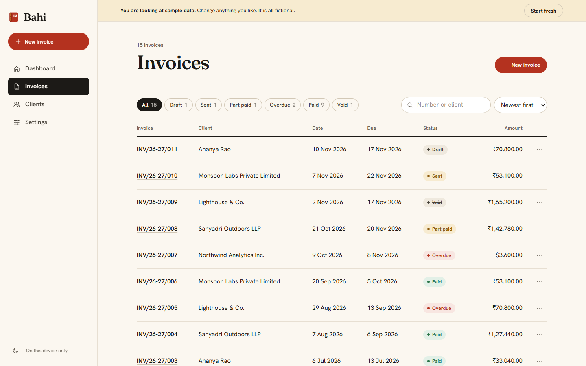                                    | 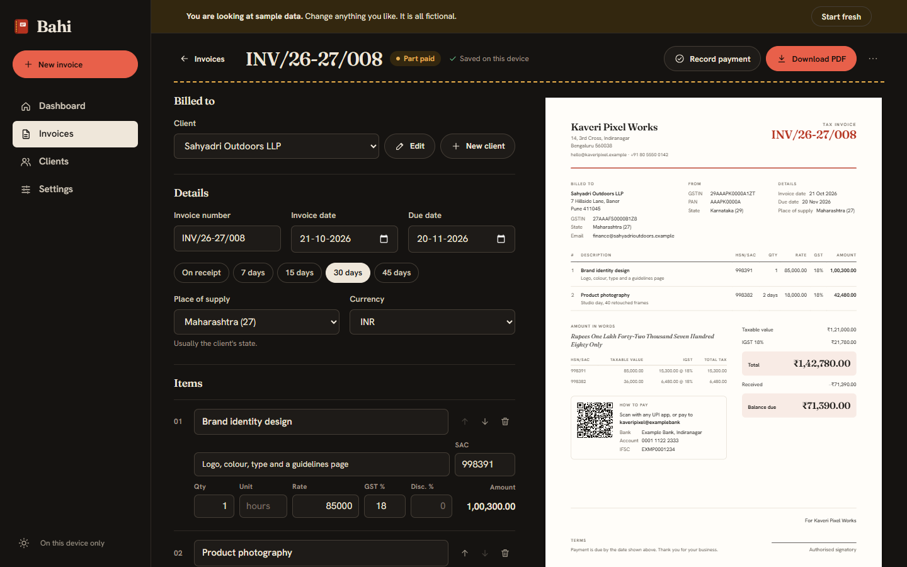 |

<p align="center">
  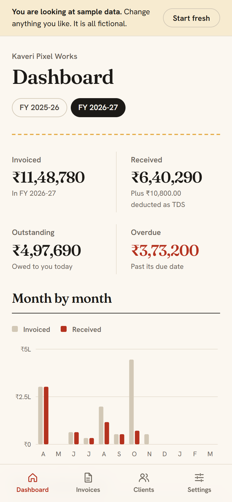
  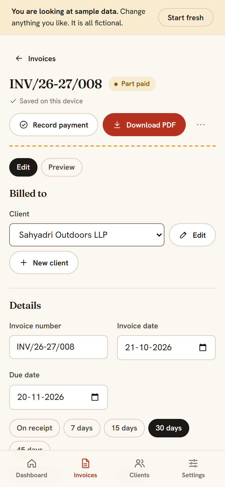
  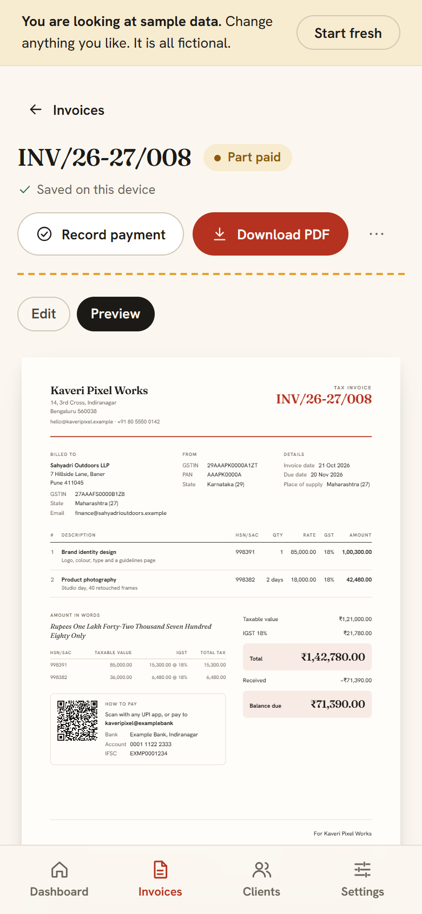
  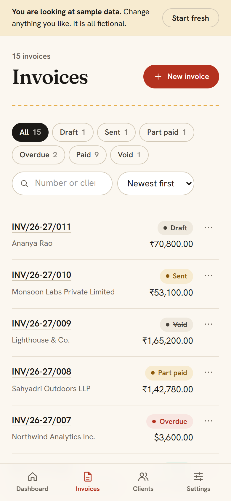
</p>

A sample invoice produced by the app: [docs/sample-invoice.pdf](docs/sample-invoice.pdf).

## How it works

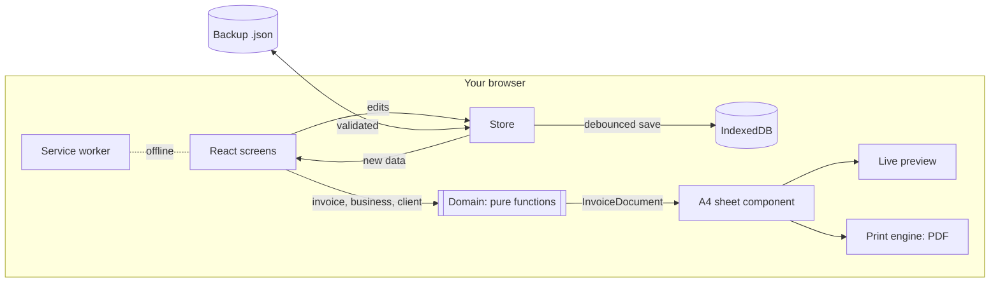

All of the tax, money and date logic lives in `src/domain/`. It is plain TypeScript with no React, no DOM and no storage, so every rule can be tested on its own. The most important function there is `buildInvoiceDocument`. It turns an invoice into every label and figure the sheet shows. The live preview and the printed PDF are the same component rendering the same `InvoiceDocument`, so they cannot disagree.

More detail is in [docs/ARCHITECTURE.md](docs/ARCHITECTURE.md).

## Engineering decisions

- **Money is integer paise, and multiplication is done on BigInt.** A float would make 3 x 33.33 come out at 99.99000000000001. Every line is rounded half up once, CGST and SGST are each rounded separately so they always match, and round-off to the rupee is shown as its own line.
- **The browser's print engine is the PDF renderer.** A PDF library would have meant a second layout to keep in step with the screen, and a large extra download. With print CSS, the one sheet component gives vector text, real fonts and an exact match with the preview.
- **Local-first, with no backend.** A server would add sign-up, hosting costs and a reason to distrust the app. The cost is that data lives on one device, so backup and restore are features in their own right, and a restored file is validated like any hostile input.
- **Validation at the edges with zod, loaded on demand.** Backups and stored data are checked field by field, unknown keys are dropped and logos must be real images. The validator only downloads when there is something to check, so a first visit does not pay for it.
- **The welcome screen is pre-rendered at build time.** A first visitor sees the real page before any JavaScript runs, and React then takes over. Each other screen is its own chunk, which brought the first-visit script from 126 KB to 77 KB gzipped.
- **A strict Content Security Policy with no exceptions.** There are no inline scripts and no inline styles (the accent colour is set through the CSSOM), no third-party origins, and no `data:` fonts. The theme is applied by a tiny external script before first paint, so dark mode never flashes.
- **Hash routing.** It works from any sub-folder on a static host such as GitHub Pages, with no rewrite rules.
- **Tax law changes, so the app cites no section numbers or thresholds.** It formats invoices; the settings page says plainly that it is not tax advice.

## Tech stack

| Area       | Choice                                                           |
| ---------- | ---------------------------------------------------------------- |
| UI         | React 19, TypeScript (strict), hand-written CSS on design tokens |
| Build      | Vite 8, server-side pre-render of the first screen               |
| Data       | IndexedDB behind a small repository interface                    |
| Validation | zod 4                                                            |
| QR codes   | uqr, drawn as a single SVG path                                  |
| Offline    | A hand-written service worker and a web app manifest             |
| Tests      | Vitest with v8 coverage, Playwright, axe-core                    |
| Fonts      | Fraunces and Hanken Grotesk, self-hosted through Fontsource      |

## Getting started

You need Node 22 or newer.

```bash
git clone https://github.com/Darshanpawar7/bahi.git
cd bahi
npm install
npm run dev        # http://localhost:4101
```

To run the production build the way GitHub Pages serves it:

```bash
npm run build
npm run preview    # http://localhost:4201/bahi/
```

## Scripts

| Script                | What it does                                                      |
| --------------------- | ----------------------------------------------------------------- |
| `npm run dev`         | Development server with hot reload                                |
| `npm run build`       | Type-check, build, and pre-render the welcome screen into `dist/` |
| `npm run preview`     | Serve `dist/` under `/bahi/`, as GitHub Pages does                |
| `npm run lint`        | ESLint (strict, type-aware) and Prettier                          |
| `npm run typecheck`   | TypeScript with no output                                         |
| `npm test`            | Unit tests with coverage thresholds                               |
| `npm run e2e`         | Browser tests against the production build                        |
| `npm run screenshots` | Re-capture the README images, the sample PDF and the banner       |

## Testing

- **141 unit tests** cover the domain layer: every supply and registration type, UTGST, reverse charge, tax-inclusive prices, round-off, the HSN/SAC summary, GSTIN checksums against five real published GSTINs, amount in words from zero to past a hundred crore and in foreign currencies, financial-year boundaries, numbering, status with TDS, UPI links, sample data, and backups including malformed and hostile files.
- **Coverage on `src/domain`** (enforced in `vite.config.ts`, measured on 11 November 2026): 99.22% statements, 95.5% branches, 100% functions, 99.76% lines. The UI is covered by the browser tests rather than counted here.
- **21 browser tests** run against the production build. They cover the sample workspace, a full invoice from client to paid with TDS, the IGST path, an invalid GSTIN, PDF output, a backup round trip, a hostile backup file, invoicing with the keyboard alone, the phone layout, and axe scans of every screen in both themes with zero serious or critical violations.
- **Lighthouse** on the local production build (mobile preset, simulated throttling, 11 November 2026): accessibility 100, best practices 100, SEO 100, performance 83 to 88 across three runs. Headless Chrome on the test machine takes over half a second to paint even a blank page, so treat the performance figure as a floor.

```bash
npm test
npx playwright install chromium   # once, if Chrome is not installed
npm run e2e
```

## Project structure

```text
src/
  domain/        pure TypeScript: money, dates, GSTIN, tax, words, numbering,
                 status, reports, the invoice view model, sample data, backups
  app/           store, persistence (IndexedDB), router, theme, commands
  features/      screens: Welcome, Dashboard, Invoices, Editor, Clients, Settings
  sheet/         the A4 invoice: one component for the preview and the PDF
  ui/            small shared parts: icons, fields, dialog, menu, toasts
  styles/        design tokens and screen styles
e2e/             Playwright and axe tests
scripts/         screenshots and the build-time pre-render
public/          service worker, boot script, manifest, icons
docs/            architecture notes, screenshots, banner, sample PDF
```

## Roadmap

- A second invoice template, and a choice between them in Settings.
- Credit notes for refunds and corrections.
- Recurring invoices for monthly retainers.
- Optional sync between devices, end-to-end encrypted, for people who want it.

## Licence

[MIT](LICENSE)

---

Designed and built by [Darshan Pawar](https://darshanpawar7.github.io) · [GitHub](https://github.com/Darshanpawar7) · [LinkedIn](https://linkedin.com/in/darshanpawar7)
